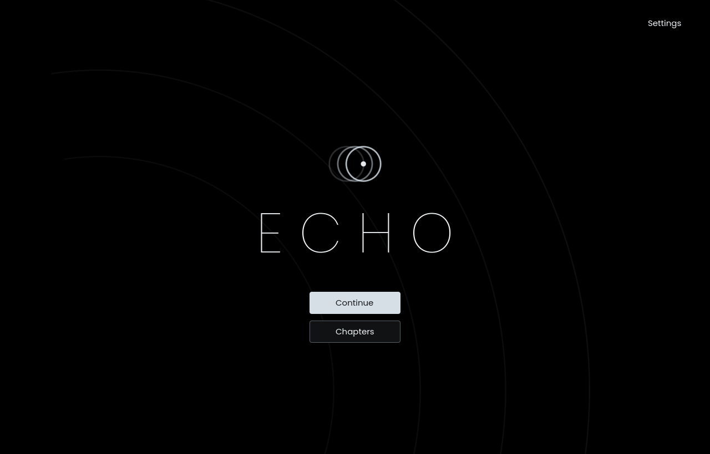
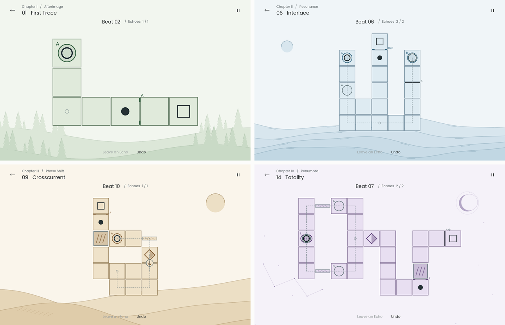
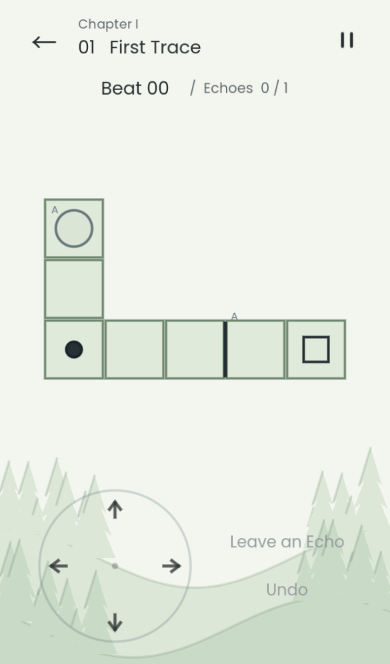
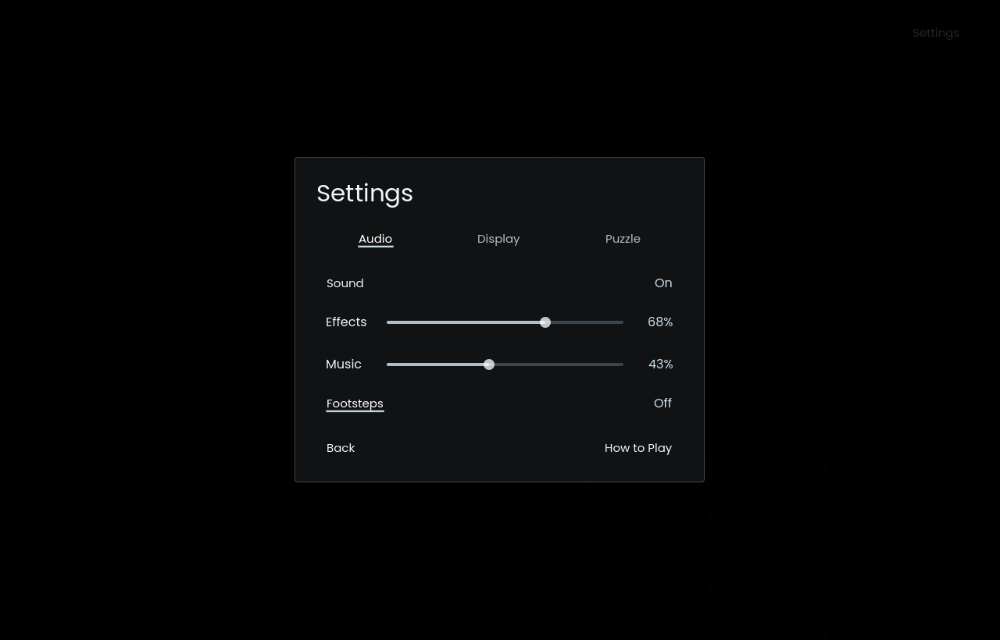
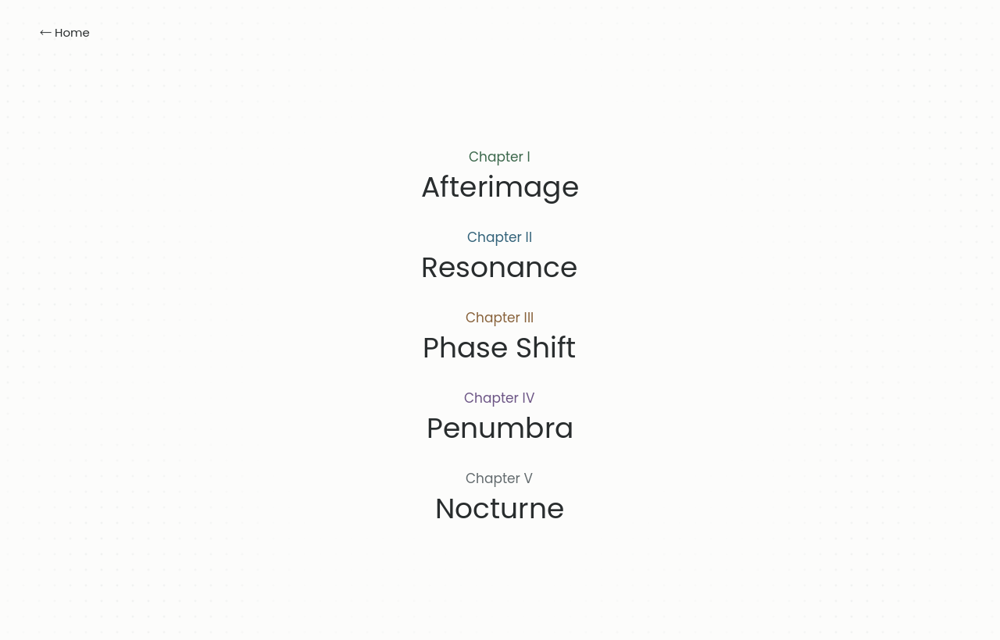
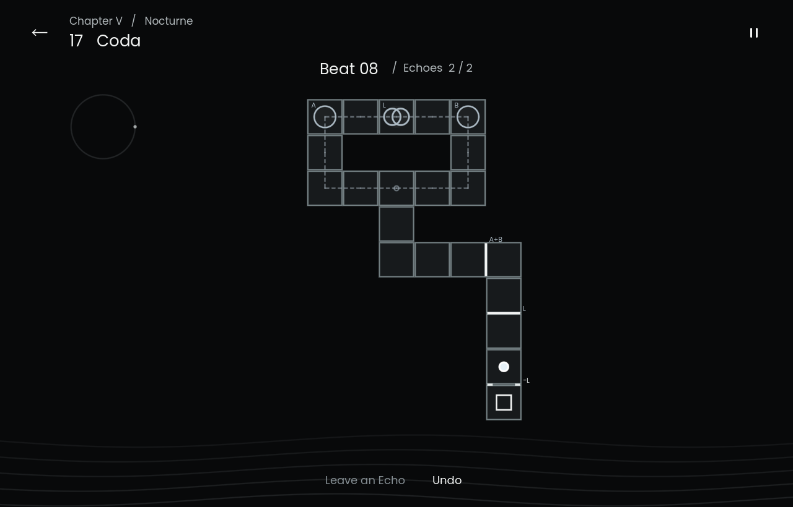

# ECHO

Every step you take moves your past selves, too.

**[Play in your browser](https://phyll1s0.com/echo/)** — on desktop or phone.

ECHO is a minimalist, turn-based puzzle game built with Godot 4.6.2. Record a route, leave an echo, and work alongside your previous selves to open a way through twenty-five rooms across seven chapters, plus the optional Extra challenge, Switchyard. There is no time pressure: the world advances only when you move.

Paper-white backgrounds, dark ink, and sparse dots frame the interface. The first four chapters explore pale green forests, blue seas, sandy hills, and a violet eclipse. Chapter V, **Nocturne**, shifts to black backgrounds and bright pieces. Chapter VI, **Wonderland**, adds coral-pink paper, a quiet Ferris wheel, and a carousel controlled from another branch. Chapter VII, **Inferno**, pairs charcoal and ember orange with four groups of sinking lava tiles. The interface defaults to English, with Simplified Chinese available in Settings.





## Run

Open `project.godot` in Godot 4.6.2 and press **F5**, or launch it from the command line:

```sh
godot --path .
```

To build the macOS app, install the Godot 4.6.2 export templates, then run these commands from the project directory. Extract `ECHO.zip` to get `ECHO.app`.

```sh
mkdir -p builds/macos
godot --headless --path . --export-release macOS builds/macos/ECHO.zip
```

## Web and mobile

The Web build uses the same Godot puzzle rules and includes both the campaign and Extra. It has a paper-white loading screen, download progress, retry handling, and a reduced-rendering fallback after graphics context loss. No download or account is required.

```sh
mkdir -p builds/web
godot --headless --path . --export-release Web builds/web/index.html
python3 tools/serve_web.py
```

Open the local URL printed by the server. Web export uses the single-threaded Compatibility renderer, so it works on GitHub Pages without cross-origin isolation headers. `web/shell.html` keeps safe-area insets and bounds the rendering resolution independently of layout size.

On touch devices, a four-way direction pad appears below the board in portrait, or beside it in landscape. Each press moves exactly one tile; holding never repeats. **Leave an Echo** and **Undo** sit beside the pad. On desktop, the pad is hidden and keyboard/mouse input remains available. Detection uses the browser's primary pointer, hover capability, and touch support; screen dimensions choose the layout, rather than treating every narrow window as a phone.

Rotating or resizing preserves the current round, echoes, and undo history. Menus, settings, and help scroll where needed. Browser progress is stored locally in IndexedDB under `user://echo/progress.json`, separate from other games on the same domain. It persists on the same browser and device; clearing site data also clears those saves. Native saves are unchanged.

The release is deployed at `/echo/` through the existing [personal-site repository](https://github.com/Phyll1s0/Phyll1s0.com), which verifies the exported files and their hashes before publishing.



## Controls

| Action | Input |
| --- | --- |
| Move one tile | Arrow keys, WASD, the touch direction pad, or an adjacent tile |
| Leave an echo | Enter or **Leave an Echo** |
| Undo one beat | Z, Backspace, or **Undo** |
| Restart the room, clearing all echoes and the current route | R or Pause → **Restart Room** |
| Edit the latest recording | Pause → **Edit Last Echo**, then undo steps or continue walking |
| Show recorded routes / reveal a hint | T / H |
| Pause / toggle fullscreen | Esc / F11 |
| Return to the page you entered from | The **←** in the upper-left corner; your current progress is saved |

The small gear in the upper-right corner of the home screen opens Settings. During play, use the pause icon or press Esc to open the sidebar. Settings has **Audio**, **Display**, and **Puzzle** tabs for music and effects levels, footsteps, fullscreen, motion, movement animation speed, room title duration, echo paths, and path contrast. Preferences save automatically. **How to Play** is available in Settings; room hints are available with H or **Hint** in the pause sidebar.

Choose **English** or **Simplified Chinese** in the language row at the top of Settings. Changes apply immediately and persist after restarting. Menus, chapter and room names, hints, instructions, and completion messages all follow the selected language. Switching languages preserves the current puzzle, pending echo edits, and undo history.



A small, unframed **?** in each chapter’s opening room explains its mechanics with short text and a looping miniature board. The guides follow your language setting, can be paused or advanced one step at a time, and start paused when Motion is off. Carousel also offers the new direction-switch guide.

Each room opens with its chapter and title, fading into the board over 1.5 seconds by default. Moving dismisses the title and takes your first step immediately.

Click a distant plate or hover over it to highlight its linked gates. Hints progress from a nudge to a complete example route.

## Rules

- Every successful move goes to an orthogonally adjacent tile and advances one beat. Backtracking is allowed. Waiting, diagonal movement, and walking through walls are not. Invalid input does not advance time.
- There is no real-time limit. When you stop moving, the world stops.
- Leaving an echo records your current route and resets the room to beat zero. Every route starts at the same position, and actors can share a tile.
- An echo can still activate a plate on its final recorded beat. It disappears on the next beat; recordings do not loop or remain at their endpoints.
- Gates sit between tiles. Whether you can cross is determined by occupancy **before the move**, then the actors move and devices update.
- **L** is a lens, drawn as two overlapping circles. At least two selves must occupy it to open an L gate. That can be you and an echo, or two echoes elsewhere on the board. An echo's final recorded beat counts.
- In Nocturne, a minus sign marks an empty-plate condition. **−A** needs A empty before the move. **−L** needs a completely empty lens; even one echo keeps it shut. **B −A** requires B occupied and A empty at the same time. An echo can satisfy an empty-plate condition by leaving or fading, and undo restores the previous occupancy.
- Gates with multiple plate requirements need all of them active at once. Only the current player can finish a room by entering the outlined square.
- Arrow gates allow passage only in the indicated direction, then reverse when crossed. Multiple actors crossing the same gate on one beat reverse it only once.
- In Inferno, lava rotates through four groups, one per successful move. Dot counts identify each tile’s group, and the cycle above the board marks the current group and the next one to sink. A move must land on a tile that is safe **after** the rotation. A submerged tile can rise as you enter it. Invalid input costs no beat; undo, recordings, and saves restore the exact phase.
- Round arrow switches reverse their linked one-way doors. These doors keep their direction when crossed; only a switch visit changes them. Echoes can operate a switch remotely, and simultaneous visits flip it once. Inspect a switch to see which doors it controls.
- Stepping onto a diamond swaps the raised and folded bridge banks. You can enter a raised bridge and leave a folded bridge beneath you. Movement uses the bank state at the start of the beat. Multiple actors triggering the shared switch bank on one beat swap it only once.
- Echoes follow their original recorded routes even after gates or bridges change, and still trigger devices. Each round starts with the initial device state. Undo restores the arrow directions and bridge banks for that beat.
- Undo restores actors, echoes, and gates. At the start of a round, it takes back the latest recording. To revise earlier recordings, undo them from newest to oldest. Before sealing an edited route, **Cancel Edit** restores the previous plan.
- Campaign progress, the current round, and preferences are stored in Godot's `user://progress.json`. Saved routes are validated by replaying every step. Restarting a room keeps completed campaign progress.

## Chapters and rooms

Choose a chapter in **Chapters** to see its rooms. **07 Turnabout**, **11 First Contact**, and **15 Hush** are available as direct chapter entries. Subsequent rooms unlock in order. Wonderland and Inferno rooms are directly accessible.



| Chapter | Room | What to discover |
| --- | --- | --- |
| I · Afterimage | 01 First Trace | Let your past self open a gate for you |
| | 02 Scenic Route | Take a two-step detour to arrive at the right beat |
| | 03 Refrain | Visit the same plate twice in one recording |
| | 04 Relay Line | Use one echo to open two gates in sequence |
| II · Resonance | 05 Two Voices | Meet two conditions on the same beat |
| | 06 Interlace | Let one recording make the next possible, then use both to reach the exit |
| III · Phase Shift | 07 Turnabout | Cross a reversed arrow gate to activate two plates in order |
| | 08 Tidal Shift | Visit a switch twice to support two crossings |
| | 09 Crosscurrent | Offset two routes by two beats and share a single device trigger |
| | 10 Counterpoint | Alternate bridge banks, then bring both echoes to the exit plates |
| IV · Penumbra | 11 First Contact | Meet your past self at a lens from the opposite branch |
| | 12 Borrowed Light | Split after a meeting: one self takes the bridge while the other reaches the switch |
| | 13 Confluence | Occupy separate plates, then converge to open a remote lens gate |
| | 14 Totality | Record crossings on raised bridges, then replay them across folded bridges to reach separate plates |
| V · Nocturne | 15 Hush | Open one gate with an echo, then let it fade before an empty-plate gate |
| | 16 Negative Space | Activate two plates together, then end one recording while the other returns |
| | 17 Coda | Separate, meet, and disappear to satisfy three gates in sequence |
| VI · Wonderland | 18 Escapement | Combine a lens meeting, arrow reversal, and bridge swaps |
| | 19 Understudy | Let one echo fade while the other returns to a plate |
| | 20 Triptych | Coordinate three recordings across the upper gallery and a remote switch |
| | 21 Carousel | Enter a ring, then let an outside echo reverse its exit door |
| VII · Inferno | 22 Cinder Walk | Read the next sinking group and choose between crossings |
| | 23 Afterburn | Meet on a lens, then time a safe echo return to A |
| | 24 Furnace | Coordinate a remote switch, four exit doors, two plates, and the lava cycle |
| | 25 Damnation | Occupy both plates to enter, then let A fade while B returns |



The former Extra rooms X01–X03 are now **18 Escapement**, **19 Understudy**, and **20 Triptych** in Wonderland. Existing completion records transfer automatically, and opening a moved room resumes its old unfinished draft. [**21 Carousel**](https://phyll1s0.com/echo/?room=21) adds a remote direction switch and two routes around its central ring. An echo must change the doors after you enter, then both recordings must reach the exit plates.

[**Chapter VII · Inferno**](https://phyll1s0.com/echo/?room=22) adds four standalone entries. Furnace has four playable approaches to its central exit. Damnation offers a shorter upper crossing and a longer lower ring, with different recording plans. Its first room includes an animated lava guide.

Open **Chapters → Extra** for [**X04 Switchyard**](https://phyll1s0.com/echo/?room=X04). Two recordings can support three distinct approaches to a central exit, each requiring a different pair of plates. It is available immediately and remembers its own unfinished route. Home → Continue resumes your campaign.

Room data and example solutions live in `data/levels.json` and `data/extra.json`. These routes verify that each room is solvable; players can find their own solutions. To launch a specific room during development, use `godot --path . -- --level=6`.

In map data, `*` marks switches belonging to the shared bridge bank. Tiles `a` and `b` represent initially raised and folded bridges. Each coordinate pair in `turnstiles` defines an arrow gate's initial direction.

A gate's `requires` array lists plates that must be active, while `vacant` lists plates that must be empty. Both sets of conditions apply together. A lens in `requires` needs at least two occupants; a lens in `vacant` needs zero.

## Validation

```sh
python3 tools/check.py
python3 tools/check.py --visual
```

An independent Python model checks maps and example solutions, then searches for the shortest final route with the supplied recordings. It verifies that every room requires an echo and that every two-echo room has no one-echo solution. Godot tests check chapter guides, remote direction switches, migrated Extra saves, and replay all solutions through both the rules model and actual keyboard and pointer input, covering fading, simultaneous crossings, empty-plate gates, missed timing, undo, editing, pause, saves, and window layouts. Empty-plate checks include delayed departures, a lens with one remaining occupant, and gates closing again after undo. Visual captures are written to `builds/`; test saves are isolated from player progress.

Phone checks exercise every room at 320×568, 390×664, 844×390, 844×300, 750×279 (landscape safe area), and 768×1024. Browser tests use real touch and keyboard events, verify echo completion and undo, rotate during a round, switch languages, reload saved progress, and check loading failure handling.

```sh
godot --headless --path . --script tests/test_mobile.gd
# With Playwright installed and the preview server running:
node tools/check_web.cjs
BROWSER=webkit node tools/check_web.cjs
```

Set `BROWSER_EXECUTABLE` if using a locally installed browser, and `ECHO_URL` to test a deployed build. `--touch` enables the pad in the native game for layout inspection.

English and Chinese interface checks cover saved language preferences, every room's text, minimum window layouts, and undo or cancellation after changing language during an echo edit. Chinese translations live in `i18n/zh_CN.po`; internal room identifiers and saves are language-independent.

For rooms with devices, search states include arrow directions and bridge banks. Rooms 07–09 are checked in separate recording and playback worlds, including searches with either device type frozen. Room 10 checks the three required exit positions and the areas that become inaccessible or trap the first switch user when devices cannot change. Room 14 also checks whether the active bridge bank allows live actors to return from the lens to the plates, establishing why replaying recorded crossings over folded bridges is necessary.

## Audio

**Stillwater** is an original 96-second stereo loop of soft piano, slow strings, and distant answering phrases. It plays continuously across the home screen, rooms, and pause menus. In **Settings → Audio**, adjust **Music** and **Effects** independently. Set Music to zero to mute it, or toggle **Footsteps** to control movement sounds separately.

## Assets

Godot draws the geometric marks and landscapes. Short effects are synthesized by `tools/make_assets.py`, with three subtle movement sounds played in rotation. The score is bundled with the game and can be regenerated from its notation with `uv run tools/make_music.py`.

Poppins is distributed under the SIL Open Font License in `assets/fonts/poppins-OFL.txt`. The bundled Chinese subset is preferred, with a system fallback on native platforms.

The bundled Noto Sans SC subset provides Chinese text in browsers, where system fonts are unavailable. It is licensed under the SIL Open Font License in `assets/fonts/noto-OFL.txt`. After adding translations, run `uv run tools/subset_font.py` to refresh its glyphs.
