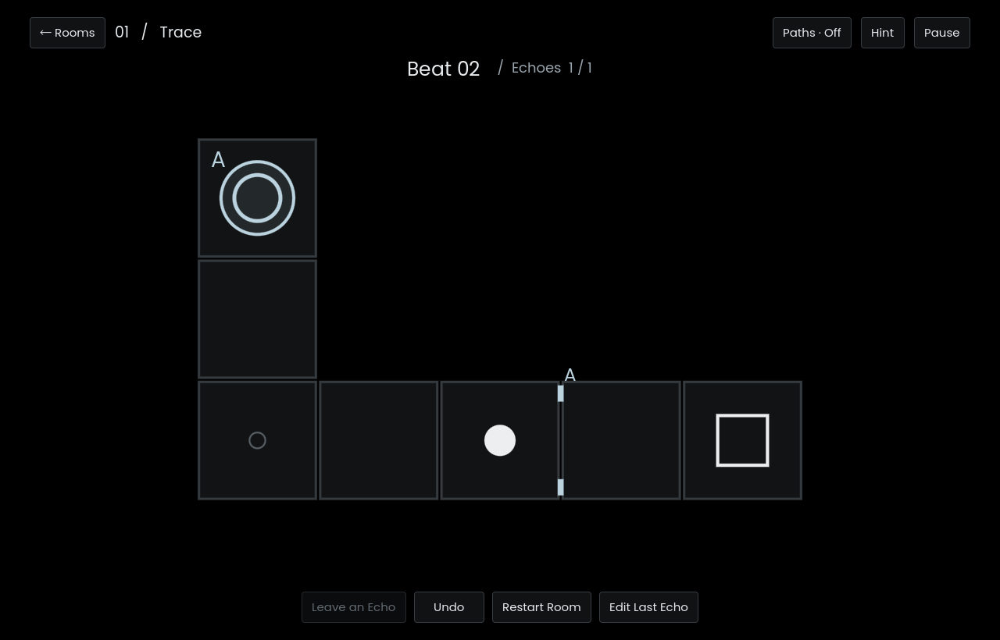

# ECHO / 回声

一个人，分几次走完同一个房间。你走一格，过去的自己也重走一格。

这是一个独立的 Godot 4.6.2 二维逻辑解谜游戏，包含六个基础房间和四个进阶房间。在 Rooms 中可直接进入 07 Ratchet，完成后依次解锁 08 至 10。界面使用英文。



## 运行

用 Godot 4.6 打开此目录的 `project.godot` 并按 F5 运行项目。命令行也可以直接运行：

```sh
godot --path .
```

要生成 macOS 应用，先安装 Godot 4.6.2 的导出模板，再在项目目录运行以下命令。解压生成的 `ECHO.zip` 即可得到 `ECHO.app`。

```sh
mkdir -p builds/macos
godot --headless --path . --export-release macOS builds/macos/ECHO.zip
```

## 操作

| 操作 | 输入 |
| --- | --- |
| 移动一格 | 方向键、WASD，或点击相邻格 |
| 留下回声 | Enter 或“Leave an Echo” |
| 撤销一拍 | Z、Backspace 或“Undo” |
| 从头重开当前房间，清空本关所有回声与行动记录 | R 或“Restart Room” |
| 修改最近的录制 | “Edit Last Echo”，然后逐拍撤销或继续走 |
| 显示录制路线 / 查看提示 | T / H |
| 暂停 / 全屏 | Esc / F11 |

点击远处的压板或将指针停在压板上可查看关联门。提示逐级展开，最后一级给出一组可行路线。

## 规则

- 一拍只允许向上下左右的相邻地板移动。折返合法，等待、穿墙和对角移动不合法。无效输入不推进时间。
- 房间内没有现实时间限制；停止输入，世界也停止。
- 留下回声会保存当前路线，把房间恢复到第 0 拍。所有记录都从同一个起点开始，角色之间互不阻挡。
- 回声到达最后一格时仍能触发压板，下一拍消散。它不会永远停在终点，也不会自动循环。
- 门位于格子之间。一次移动使用**移动前**的压板状态判定能否通过，随后全体角色同时行动并更新机关。
- 条件门要求标出的压板同时有人。只有当前角色进入方框出口时才完成房间。
- 箭头门只允许沿箭头穿过。穿过后箭头反向，方向一直保留到下次穿越。同一拍有多个角色穿过时，门转动一次。
- 踩上菱形开关，两组桥面交换。平展的桥可以进入，收起的桥只能离开。一次行动按起步时的桥面判定，多个角色同拍踩到同组开关也只切换一次。
- 回声保留录制时走过的路线，即使后来改变了门或桥，也会继续回放并触发机关。每轮从初始机关状态开始，撤销会恢复该拍的箭头方向和桥面。
- 撤销会恢复角色、回声和门；在新一轮的起点撤销会撤回上次录制。修改较早的记录时，从最近的回声逐段撤回。在重新留下回声之前，可以取消修改，恢复之前的完整方案。
- 关卡进度、当前轮和声音／动效偏好保存在 Godot 的 `user://progress.json`。读档会逐拍验证每段录制。

## 房间

| 关卡 | 回声名额 | 要发现的关系 |
| --- | ---: | --- |
| 01 Trace | 1 | 第一次让过去的自己为现在的自己开门 |
| 02 Detour | 1 | 改变路线长度，让回声在需要的那一拍到达 |
| 03 Reprise | 1 | 一段记录两次经过同一压板 |
| 04 Relay | 1 | 同一个回声先后负责两扇门 |
| 05 Duet | 2 | 两段记录在同一拍满足双重条件 |
| 06 Interlock | 2 | 第一段记录为第二段开路，再共同开启出口 |
| 07 Ratchet | 1 | 利用反向后的箭头门，在一段行动里先后为两道门提供条件 |
| 08 Switchyard | 1 | 两次踩中菱形开关，配合另一条路线的两次过桥 |
| 09 Undertow | 1 | 在共享转门前错开两拍，再利用同拍触发只切换一次的规则 |
| 10 Counterpoint | 2 | 第一段回声铺桥、折返开门，第二段回声切回桥面，最终占住两个出口压板 |

数据与参考路线位于 `data/levels.json`。参考路线用于验证可达性，不要求玩家使用同一路线。可用 `godot --path . -- --level=6` 直接进入指定房间进行开发调试。

新机关在地图中使用 `*` 表示同组菱形开关，`a` 和 `b` 分别表示初始展开和初始收起的桥。`turnstiles` 中每对相邻坐标的顺序给出初始通行方向。

## 验证

```sh
python3 tools/check.py
python3 tools/check.py --visual
```

独立 Python 模型检查地图和参考路线，并在给定录制的情况下搜索最终轮的最短路径。所有房间均检查无回声无法通关；双回声房间的出口同时需要两块不同压板和独立的门前位置。Godot 测试另行回放全部解法与实际键鼠输入，检查消散、同拍穿门、错过时机、撤销、重录、暂停、读档和窗口布局。视觉测试的截图写入 `builds/`，测试存档与玩家存档分离。

进阶房间的搜索状态包含箭头方向与桥面。对 07 至 09，验证器同时搜索录制世界和回放世界，检查固定其中一种新机关后是否存在替代解。对 10，验证器检查出口所需的三个位置，以及固定机关后不可达的位置或无法离开的开关区域。

## 素材

几何标记和场景由 Godot 绘制。四个短音效用 `tools/make_assets.py` 合成；字体 Poppins 遵循 `assets/fonts/poppins-OFL.txt` 中的 SIL Open Font License。中文文字使用系统字体回退。
